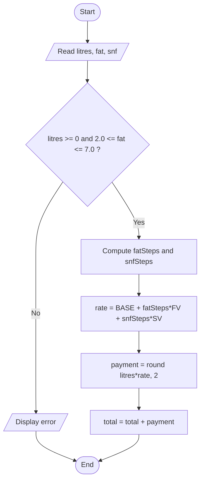

# Task 8 - Plan the Algorithm

## Stages of problem solving
1. Understand - inputs, outputs, rules (Task 1).
2. Plan - pseudocode / flowchart, choose data structures.
3. Write - translate the plan into Python.
4. Test - normal, boundary and invalid cases; trace by hand.

## Pseudocode 1 - one payment
(Adapt keywords to the SIMATS pseudocode standard from your class notes.)
```
ALGORITHM CalculatePayment
INPUT : litres, fat, snf
OUTPUT: payment
CONSTANTS: BASE=30.00, STD_FAT=3.5, STD_SNF=8.5, FV=0.40, SV=0.30
BEGIN
  IF litres < 0 OR fat < 2.0 OR fat > 7.0 THEN
      DISPLAY "Invalid entry"; RETURN
  END IF
  fatSteps <- ROUND((fat - STD_FAT) / 0.1)
  snfSteps <- ROUND((snf - STD_SNF) / 0.1)
  rate     <- BASE + fatSteps * FV + snfSteps * SV
  payment  <- ROUND(litres * rate, 2)
  RETURN payment
END
```

## Pseudocode 2 - ten-day total
```
ALGORITHM TenDayTotal
INPUT : list of entries (litres, fat, snf)
OUTPUT: total
BEGIN
  total <- 0
  FOR each entry IN entries DO
      IF entry is valid THEN
          total <- total + CalculatePayment(litres, fat, snf)
      ELSE
          DISPLAY "Skipped invalid entry"
      END IF
  END FOR
  RETURN total
END
```

## Flowchart (Mermaid - paste into mermaid.live or draw.io, then export image)


## Hand trace
| Entry | litres | fat | snf | fatSteps | snfSteps | rate | payment | running total |
|---|---|---|---|---|---|---|---|---|
| 1 | 10 | 3.5 | 8.5 | 0 | 0 | 30.00 | 300.00 | 300.00 |
| 2 | 8.5 | 4.2 | 8.7 | 7 | 2 | 33.40 | 283.90 | 583.90 |
| 3 | 12 | 3.1 | 8.3 | -4 | -2 | 27.80 | 333.60 | 917.50 |

(Run `trace.py` to confirm the table matches the program.)

## Additional question: list vs running total
| | Store all entries then total | Running total |
|---|---|---|
| Time | O(n) | O(n) |
| Space | O(n) | O(1) |
Retaining entries is necessary for reprinting/auditing payment slips, correcting an entry
and recalculating, statistics (max, median), sorting or reporting per shift.
